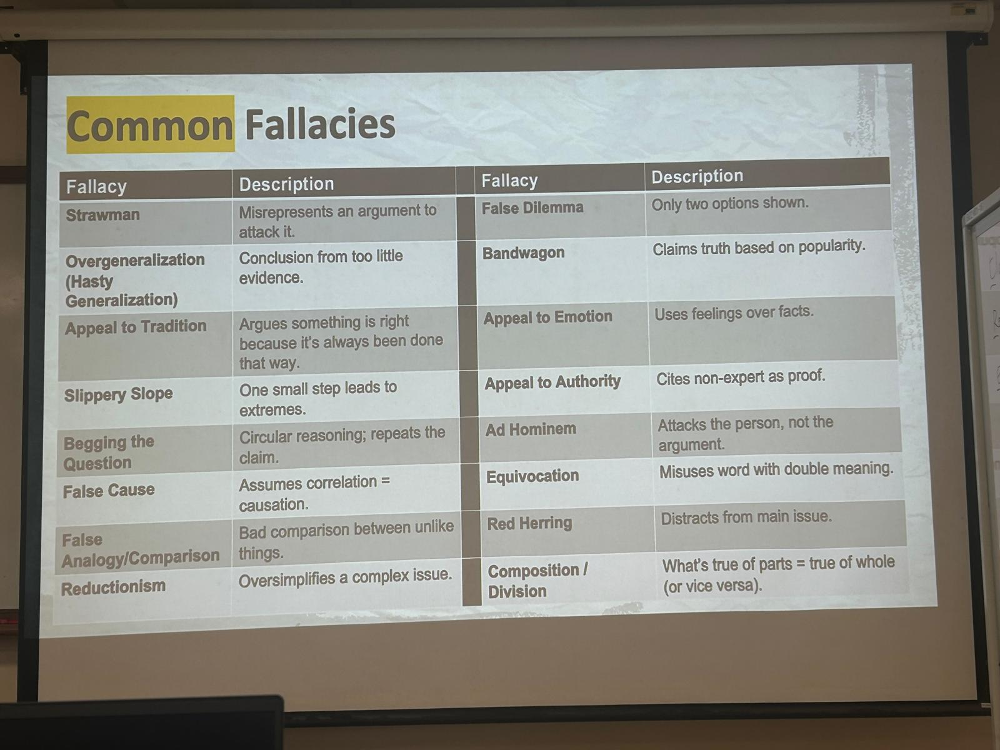

# ES2660 CA 2 & 3 planning

Persuasion
- Kairos: persuading by responding to the right moment, situation or circumstances
    - Urgency - why now?
- Logos: persuading through responding, evidence and logic
    - line of logic, leading to effective thesis statement
- Ethos: establishing credibility and trustworthiness
    - Sources - make your CHECK YOUR SOURCES (at least the abstract)
- Pathos
    - Relevance, hook - how to engage the readers emotionally? images? videos?

Thesis statement
Core elements
- takes a clear position
- does it make a specific claim?
- does it suggest two main reasons?
- is it arguable?
- does it have a niche?

## Know your audience
background
- they have an interest in your topic or you
- they have higher education or specialised professional training
- they work in various fields and sectors
- they may not have specialised knowledge or technical expertise in the issue you are writing about

How do you write for audiences from diverse backgrounds?
- explain relevance to audience
- define key terms
- logical organisation
- credible evidence
- clear reasoning

## Develop clear logical flow
- Clear title that hints to stance and thesis
- Use subheadings to organize ideas
- Use transition words to connect ideas within paragraphs
- Use clear paragraphs - claim --> reasoning --> evidence
- Use pictures/videos to support comprehension (logos) or evoke emotions (pathos)

## Toulmin's argument model
Parts
1. claim - same as c
2. grounds - same as e
3. warrant - same as r
4. backing - additional support for warrant
5. qualifier - can be anywhere - avoid over-generalization fallacy - acknowledging claim may not be true in all scenarios
6. rebuttal - to the claim - acknowledgement of alternative valid views
7. conclusion/summary (optional)

excercise

## Logical fallacies

## CA2 Rubric
Content (50)
- Engaging and relevant hook: reels in the audience
- Highly effective contextualization of the issue:
    - Why is it relevant?
    - Why is it urgent and why should we care about it right NOW?
    - Leads logically to a clear thesis
- A clear thesis: states the central argument and informs audience on how argument will develop

Organization (10)
- Clear, logical and convincing line of reasoning
- Effective and engaging paragraphing
- Effective use of cohesive devices

Language (40)
- Clear, concise, purposeful and appropriate expressions
- Tailored to genre/medium and audience
- Skillful integration of sources through paraphrasing and contextual hyperlinks
- All sources fully cited using IEEE
